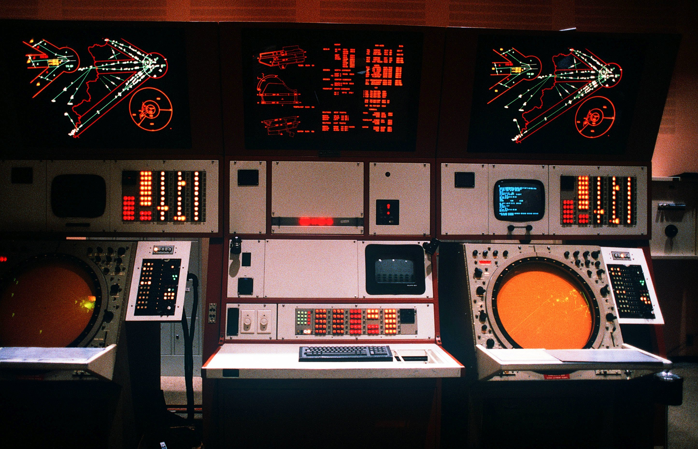

# Uita design system — Tempelhof, circa 1987

Version: 1.0 · Design direction: 2026-10-17 · Status: canonical target, not an implementation audit.

## Scope and authority

Read this file before designing or changing frontend interfaces in `web/` or `frontend/`.
It defines visual decisions, interface language, and observable acceptance conditions.
The token block below defines target values. Existing styles may differ until migrated.

This direction replaces the earlier navy-and-cyan visual direction.
`frontend/DESIGN.md` retains implementation context; `.impeccable/design.json` and existing design audits describe earlier work.
Those records do not override this file. Preserve product behavior and evidence requirements during visual changes.

The intended audience is simulation researchers, technical evaluators, and demo visitors inspecting air traffic.
Their main jobs are to locate traffic, inspect evidence, control replay, and compare outcomes.
This audience follows the project's current product assumption in [PRODUCT.md](PRODUCT.md).

The aesthetic comes from Oscar's [supplied control-room photograph](docs/design/tempelhof-control-room-reference.png).
“Tempelhof, circa 1987” names the requested inspiration; the photograph's date and equipment are not independently authenticated.
Colors, type, and dimensions below are modern design choices, not recovered historical specifications.



## Design intent

**Build a quiet instrument room where light carries information.**

The interface should feel precise, patient, tactile, and continuously useful.
Large dark displays sit within warm equipment panels. Small signals attract attention because the surrounding surfaces remain quiet.
The reference's character comes from the relationship between materials, display types, and functional density.

### What to carry forward

| Visible quality | Frontend translation |
| --- | --- |
| Nearly black display glass | Deep green-black work surfaces with clear, luminous information |
| Warm gray equipment faces | Putty-colored control bands, label plates, and instrument frames |
| Dark cabinet divisions | Narrow structural seams and aligned panel edges |
| Red-orange technical drawings | Fine fixed-reference geometry and instrument readouts |
| Pale green tracks and white targets | Calm traffic traces, precise symbols, and readable labels |
| Amber circular scopes | A distinct instrument treatment for actual polar or radar data |
| Small cyan terminal | A secondary channel for machine messages and diagnostics |
| Dense lamps and physical keys | Compact, labeled state groups and deliberate controls |
| Low room light and localized emission | Flat matte surfaces with very limited signal glow |

### Non-negotiable decisions

- Give each workspace one dominant inspection surface and a clear route to its supporting evidence.
- Separate the material of the cabinet from the light of the display.
- Assign colors to information roles. Keep selection, warnings, and data categories distinguishable.
- Use square modules, aligned baselines, thin rules, and restrained corner radii.
- Keep measurements, units, timestamps, sources, and missing-data states explicit.
- Preserve readability before texture, density, or period detail.

## Color system

### Canonical tokens

Use these custom property names when implementing the system.
They are a proposed contract, not an existing imported stylesheet or component library.
Place them in the active app's shared theme stylesheet when implementing this direction.
Keep component colors bound to these roles instead of adding local color literals.

```css
:root {
  color-scheme: dark;

  /* Matte structure and warm equipment faces. */
  --atc-room: #100e0c;
  --atc-cabinet: #221b17;
  --atc-panel: #b8b0a0;
  --atc-panel-raised: #ccc3b3;
  --atc-panel-recess: #918a7d;
  --atc-paper: #e6dfce;
  --atc-ink: #25231e;
  --atc-ink-muted: #48443b;
  --atc-rule-panel: #5c564a;

  /* Display glass and readable content. */
  --atc-screen: #060c0b;
  --atc-screen-raised: #101a17;
  --atc-screen-hover: #182620;
  --atc-text: #e8e3d5;
  --atc-text-secondary: #a9b6a3;
  --atc-text-dim: #7e9180;
  --atc-rule: #35433b;
  --atc-rule-strong: #657a6c;

  /* Emitted signals. */
  --atc-vector: #f34d32;
  --atc-orange: #ff6a2b;
  --atc-amber: #f6c45a;
  --atc-green: #a8d5a3;
  --atc-cyan: #83d8dd;
  --atc-red: #ff7165;
  --atc-selection: #233d2b;
  --atc-focus-dark: var(--atc-cyan);
  --atc-focus-panel: #1b4f54;

  /* Type. Serve approved font files locally. */
  --atc-font-ui: "IBM Plex Sans Condensed", "Helvetica Neue", sans-serif;
  --atc-font-data: "IBM Plex Mono", "Courier New", monospace;

  /* Spacing, in CSS pixels at the default root size. */
  --atc-space-1: 4px;
  --atc-space-2: 8px;
  --atc-space-3: 12px;
  --atc-space-4: 16px;
  --atc-space-5: 24px;
  --atc-space-6: 32px;
  --atc-space-7: 48px;

  --atc-radius-panel: 2px;
  --atc-radius-control: 2px;
  --atc-radius-screen: 6px;
  --atc-rule-width: 1px;
  --atc-control-min: 44px;
  --atc-inspector-width: 352px;

  --atc-duration-control: 100ms;
  --atc-duration-panel: 160ms;
  --atc-ease: cubic-bezier(0.2, 0, 0, 1);
}
```

### Surface hierarchy

| Layer | Surface / text | Use |
| --- | --- | --- |
| Room | `room` / `text` | Page surround and gaps between instruments |
| Cabinet | `cabinet` / `text` | Structural rails and deep outer frames |
| Equipment face | `panel` / `ink` | Controls, engraved labels, toolbar bands |
| Raised key | `panel-raised` / `ink` | Neutral physical-button treatment |
| Display | `screen` / `text` | Maps, timelines, tables, transcripts |
| Secondary display | `screen-raised` / `text-secondary` | Inspectors and supporting readouts |
| Flight strip | `paper` / `ink` | Selected records, printable summaries, evidence sheets |

Names in the tables omit the `--atc-` prefix for readability.
`panel-recess` is a material detail; keep essential small text on the approved surface pairs.
`rule` separates rows decoratively. Use `rule-strong` where an edge identifies an interactive control.

Aim for roughly 70–80% dark surfaces, 15–25% equipment faces, and less than 5% vivid signals in an operational view.
These proportions guide composition; they are not quotas for reports or small screens.
Keep cabinet brown confined to structure. Warmth should come mainly from putty panels and signal light.

### Signal semantics

| Token | Meaning | Boundary |
| --- | --- | --- |
| `vector` | Fixed diagram geometry, runway outlines, reference sectors | Drawing layer only; never an unlabeled alarm |
| `orange` | Instrument values and short readouts | Avoid paragraphs and large filled backgrounds |
| `amber` | Attention, pending verification, unresolved evidence; primary action fill | Context and labels distinguish action from status |
| `green` | Normal tracks and confirmed states | A track's presence does not imply verification |
| `cyan` | Terminal information, keyboard focus, explicit comparison series | A secondary accent, not the entire brand |
| `red` | Failure, rejected operation, or verified warning condition | Pair with a symbol and specific state text |
| `text` | Main labels, selected target center, readable prose | Highest reading priority |

Use `selection` as a row fill, with a solid leading marker and `aria-selected` where appropriate.
Use a double target bracket for spatial selection. Keep selected labels in `text`.
Selection is an outline or shape change; it does not recolor every related value amber.

On equipment faces, use dark ink for text. Put luminous status text inside a dark inset or pair dark text with a colored lamp.
Orange, cyan, and green text on putty panels are not approved text pairs.

For categorical charts, start with green and cyan; distinguish further series with line patterns and direct labels.
Reserve amber and red for their state meanings. Keep arrival/departure categories independent of warning severity.
If existing category colors change, update their legends and every linked view together.

### Contrast requirements

Target WCAG 2.2 AA: 4.5:1 for normal text, 3:1 for large text, and 3:1 for essential control boundaries and graphics.
Large text means at least 24 CSS px regular or approximately 18.7 CSS px bold.
Verify actual rendered combinations, including hover, selection, compositing, and focus.
Glow and shadow do not count toward contrast.

Baseline sRGB contrast calculations for opaque token pairs, rounded to one decimal:

| Foreground / background | Contrast |
| --- | ---: |
| `text` / `screen` | 15.4:1 |
| `text-secondary` / `screen` | 9.3:1 |
| `text-dim` / `screen-raised` | 5.3:1 |
| `ink` / `panel` | 7.3:1 |
| `ink` / `amber` | 9.7:1 |
| `orange` / `screen` | 6.9:1 |
| `rule-strong` / `screen-raised` | 3.9:1 |
| `rule-panel` / `panel` | 3.4:1 |

## Display taxonomy

Choose a display from the information's job. A page can combine several types within one cabinet structure.
Display type controls rendering; it does not change the meaning of warning or verification states.

| Type | Information and appearance | Implementation rules |
| --- | --- | --- |
| **Vector display** | Airspace, routes, runway geometry; green-black glass, fine red-orange reference lines, pale tracks | Use SVG for bounded diagrams or the existing geographic renderer for maps. Keep labels as readable text. |
| **Radar scope** | Actual polar range and bearing data; circular plotting field within a rectangular instrument | Draw rings and radial marks only when their scale is meaningful. Use sparse amber marks, not a solid orange disk. |
| **Raster terminal** | Event logs, radio transcripts, agent activity, diagnostics; cyan or pale green text on dark glass | Use selectable DOM text. Align timestamps and speakers. Wrap messages; preserve source and event time. |
| **Lamp matrix** | Small sets of discrete states, resource occupancy, connection state | Each lamp maps to a real state. Provide labels and a text equivalent. Avoid decorative banks of random lights. |
| **Numeric instrument** | Clock, replay rate, heading, speed, range, bounded counters | Use tabular monospace values with persistent units. Ordinary numerals are the default. |
| **Flight strip / evidence sheet** | Individual aircraft records, comparisons, verification results | Use warm paper or dark ruled rows. Align fields and expose provenance. Permit selection and copying. |
| **Control bank** | Playback, filters, source selection, mode changes | Use grouped rectangular controls on an equipment face. Make pressed and unavailable states explicit. |

### Drawing grammar

- Use 1px reference strokes and 1.5–2px active traces at the standard viewport scale.
- Keep line weights stable during zoom where the renderer supports it.
- Give targets a 6–8px visible symbol and at least a 44px interaction region when interactive.
- Label callsign, relevant altitude, and speed in a compact block with units or a persistent unit header.
- Render history as a dimmer or dashed trail. Render predicted paths with a distinct dash pattern and a `Predicted` legend.
- Show conflicts with an explicit connector or outlined region plus a readable explanation.
- Give diagrams a scale, legend, source, and time basis when these affect interpretation.
- Resolve label collisions by priority: selected target, warning target, then normal traffic.

A geographic map remains geographically correct. Do not force it into a circular scope or add a decorative radar sweep.
A 3D scene remains schematic where the underlying geometry is schematic.
Keep essential aircraft and evidence information available in a table when the renderer fails or is inaccessible.

Seven-segment numerals are optional for a large clock only.
Use ordinary text for headings, forms, tables, and values that need precise reading or copying.
The reference's glowing hardware is an inspiration for hierarchy, not a requirement to rasterize the interface.

## Typography

Use a restrained industrial sans serif for labels and prose, with monospace for operational data.
The pairing suggests engraved equipment and terminal output without turning the entire application into a terminal.

| Role | Family | Size / line height | Weight / tracking |
| --- | --- | --- | --- |
| Page title | UI | 24–32px / 1.15 | 500 / 0.01em |
| Instrument title | UI | 16–18px / 1.25 | 600 / 0.04em |
| Panel label | UI | 12–13px / 1.35 | 600 / 0.08em |
| Body and explanation | UI | 15–16px / 1.5 | 400 / normal |
| Control label | UI | 14px / 1.2 | 500 / 0.02em |
| Data and tables | Data | 13–14px / 1.5 | 400 / normal |
| Supporting metadata | Data | 12px / 1.4 | 400 / normal |
| Main clock / key reading | Data | 24–40px / 1.1 | 500 / normal |

Use rem equivalents in CSS so browser text settings remain effective.
Use uppercase for short equipment labels, tab names, and state stamps.
Use sentence case for prose, help text, errors, and action labels. Preserve aircraft and source identifiers exactly.
Keep paragraphs near 45–70 characters per line; let evidence tables use the available width.

Set `font-variant-numeric: tabular-nums slashed-zero` for operational values.
Right-align numeric table columns. Keep decimal precision consistent within each column.
Use nonbreaking value/unit pairs where appropriate; put common units in column headers for dense tables.

IBM Plex Mono already exists in `frontend/`; the proposed condensed UI family is not currently bundled there.
Existing DM Sans may remain during a scoped migration. Record that difference instead of silently claiming a completed font change.
Use locally served WOFF2 files, required weights only, and `font-display: swap`.
Keep meaningful interface text at 12px or above. Increase density through grouping and column design before shrinking text.

## Layout and spatial rules

Build connected instruments, rather than a collection of detached cards.
Use the 4px spacing base: 4–8px within fields, 12–16px within groups, and 24–32px between major groups.
Use 8px cabinet seams and 16–24px display padding.
Keep the main map edge, inspector headings, table columns, and transport controls on shared alignments.

### Operational workspace

```text
+------------------------------------------------------------------+
| UITA / SFO     RECORDED REPLAY      source + clock       connection |
+--------------------------------------------+---------------------+
|                                            | TRAFFIC / EVIDENCE  |
|                                            +---------------------+
|         PRIMARY MAP OR SCHEMATIC            | selected aircraft   |
|         dark instrument glass              | measurements        |
|                                            | provenance / states |
+--------------------------------------------+---------------------+
| PLAYBACK    time range / timeline / speed / step / selected event  |
+------------------------------------------------------------------+
| source freshness / coverage / research limitation                 |
+------------------------------------------------------------------+
```

This diagram defines hierarchy, not fixed pixel tracks or a required feature list.
Show only controls and modes the active app supports.
On wide screens, give the primary display approximately two thirds of the usable workspace.
Use an inspector near the width token, adjustable within roughly 320–400px when content requires it.
Keep the time basis visible near the main clock. Keep coverage and connection details separate from flight-state claims.

Use a top identity band around 56–64px high and a control bank sized to its actual controls.
Let the main display expand. Avoid large marketing headings inside the operational workspace.
Inspector content can scroll independently on a wide screen; always show a clear overflow affordance.

For comparison pages, use aligned columns or matched plots with common axes and a shared time basis.
For reports, lead with the question, result, and limits, then full-width evidence.
The cabinet language can frame a report without forcing it into the operational shell.

### Responsive behavior

| Available width | Composition |
| --- | --- |
| 1200px and above | Main display and inspector side by side; full control groups |
| 800–1199px | Narrower inspector or a labeled inspector toggle; controls wrap by group |
| Below 800px | Display, selected record, controls, and supporting evidence in document flow |

Treat these as starting breakpoints. Switch when content no longer fits, not according to device names.
On small screens, keep playback and selection reachable; use text-labeled tabs for traffic, evidence, or logs when needed.
Use at least 320px of display height where space permits. Allow document scrolling instead of compressing every panel into one viewport.
At 320 CSS px, essential controls and prose must reflow without page-level horizontal scrolling.
Wide evidence tables may scroll in a labeled, keyboard-accessible region; retain identifying columns where feasible.
Support 200% zoom and check reflow at 400%. Never remove critical functionality to fit the visual frame.

## Component contracts

These names define recommended primitives. They do not claim existing React exports.
Reuse or adapt current components before introducing a second component layer.

| Primitive | Required treatment and behavior |
| --- | --- |
| `InstrumentPanel` | Putty face or dark cabinet frame; a readable heading; one inset display; optional metadata footer |
| `DisplaySurface` | Screen tokens, 6px inner radius at most, 16–24px padding; no required decorative effects |
| `ControlBank` | Related actions share a face and alignment; gaps clarify groups; state labels remain visible |
| `StatusLamp` | 6–8px lamp plus explicit text; shape/icon reinforces severity; accessible name includes state |
| `Readout` | Label, value, unit, and optional timestamp/source; missing values have a reason |
| `FlightStrip` | Stable field positions, visible selection, data provenance, no forced truncation of essential identity |
| `EvidenceTable` | Semantic headers, aligned numbers, sorting state, full available width, a defined overflow strategy |
| `EventLog` | Time, source/speaker, message, state; stable scroll position; optional “Follow latest” control |
| `Timeline` | Labeled time axis, current-position marker, keyboard seeking, explicit range and speed |

### Buttons and navigation

Primary action: amber fill, dark ink, 2px corners, and a visible strong boundary.
Use one primary action per local task group. Label the action: `Play`, `Run comparison`, or `Export evidence`.
Secondary actions use a raised putty key with dark ink, or a dark outlined key inside a display.
Destructive actions use explicit verbs and a red state marker; keep routine controls visually calm.

Use at least 44px control height and 44×44px hit regions for icon buttons.
Keep visible icons around 16–20px and provide accessible names.
Pointer hover shifts the surface and reinforces the boundary. Pressed keys gain an inset shadow and a clear state change.
Toggle buttons expose `aria-pressed`; single-view selectors use the appropriate native or ARIA pattern.
Active tabs use a solid marker, readable label, and `aria-selected`, rather than color alone.

Use a 2px focus ring with a 3px offset.
Use `focus-dark` on dark surfaces and `focus-panel` on putty surfaces.
Ensure rings remain visible around amber buttons and are not clipped by cabinet frames.
Unavailable controls keep readable labels, disable activation, and show the reason nearby.
Avoid reducing opacity across the whole control group.

### Fields and selectors

Keep labels visible above or beside fields; placeholders provide examples only.
Use dark inset fields with `text` and `rule-strong`, or light fields with `ink` and `rule-panel`.
Give errors specific text tied to the field. Preserve entered data after a validation error.
Use native selects, number inputs, and range inputs when they meet the interaction need.
Style a range as a linear instrument track. Provide a numeric value or step controls for precise adjustments.
Rotary knobs are visual metaphors only unless a real continuous parameter justifies an accessible dial.

### Tables, logs, and overlays

Use ruled rows with 8–12px vertical padding and sticky headers where helpful.
Keep important identity and status fields readable at default density.
Sorting, filtering, and selection must agree across the table, map, and inspector.
Avoid moving rows under the pointer merely because new data arrives; offer a stable ordering or explicit follow mode.

Use an inspector for routine detail. Use a dialog for a bounded action that requires focused input.
An open modal manages focus, names itself, closes with Escape when appropriate, and returns focus to its trigger.
Overlay depth comes from cabinet edges and a restrained shadow; the foreground remains opaque and readable.

## Interface language

Write like a calm instrument operator: short, specific, and factual.
Show the user's current mode and what the displayed values mean.
The visual era does not require obscure aviation shorthand or fictional German labels.
Use domain terms when they improve precision; explain unfamiliar abbreviations at first use or through nearby help.

| Situation | Preferred copy |
| --- | --- |
| Historical view | `Recorded replay` with the actual source date and displayed time zone |
| Simulation view | `Simulation` with scenario or run identity |
| Unavailable value | `—` plus `Not recorded`, `No matched path`, or another specific reason |
| Pending check | `Verification pending` |
| Incomplete evidence | `Unresolved — altitude evidence unavailable` |
| Rejected change | `Plan rejected — runway reservation overlaps` when supported by the verifier |
| Empty selection | `Select an aircraft to inspect its track and evidence.` |
| Failed fetch | `Traffic could not load. Retry.` with a working retry action |
| Stale source | `Last update 14:32 UTC. Connection lost.` using the actual recorded time |
| Renderer failure | `Map unavailable. Traffic records remain available below.` |

Examples define phrasing, not fixture values or required capabilities.
Choose precision for the task; seconds are appropriate for a replay clock, while source freshness may need only minutes.
Never imply live traffic when showing historical records or simulation.
Show the time zone explicitly, and distinguish replay time from wall-clock time.
Use `ft`, `kt`, `NM`, and degrees consistently; state altitude reference when known and relevant.

Place limitations next to the affected value or result.
A concise research-use notice belongs in the workspace status area, not across every instrument.
Show pass, fail, unresolved, missing, and not evaluated as distinct states.
Do not describe a candidate as verified, safe, improved, or accepted unless the corresponding evidence supports that claim.

## Lighting and atmosphere

The room is dim; the information is lit. Equipment faces stay matte and readable.
Warm panel surfaces and occasional orange emission supply warmth without a page-wide color wash.
Depth comes from a dark outer frame, a shallow face, and an inset screen.

| Layer | Allowed treatment | Limit |
| --- | --- | --- |
| Cabinet frame | One darker edge and a restrained top highlight | No elaborate metal illustration |
| Panel face | Mostly flat fill; optional very slight top-to-bottom luminance shift | No polished chrome or glass blur |
| Screen | Dark inset; optional inner edge shadow | Keep the data plane evenly readable |
| Signal | Sharp center with a small local halo | Glow is optional and never carries meaning |
| Ambient light | Small warm accent near a bezel or active lamp | No whole-page bloom or colored fog |
| Texture | Optional static grain on cabinet surfaces | At most 2% opacity; absent from text and chart layers |

An acceptable screen inset is `inset 0 1px 4px rgb(0 0 0 / 45%)`.
An acceptable lamp halo is `0 0 6px rgb(255 106 43 / 18%)` around an orange lamp.
Keep body text, table values, form labels, and fine chart lines sharp and unglowed.

Default operational displays have no scanline overlay.
If a display-only illustration needs scanlines, keep them static, below 2% opacity, clipped to that illustration, and hidden from assistive technology.
Film grain, dust, lens distortion, screen curvature, vignette, and chromatic aberration must not interfere with actual work surfaces.
Reproduce the reference's visual hierarchy rather than the camera's blur or exposure artifacts.

For an existing 3D view, use restrained neutral lighting, rough materials, and clear runway/aircraft separation.
Let the instrument frame establish the period character. Preserve the scene's geographic orientation and data meaning.

## Motion and sound

Motion explains state or time. Control transitions last up to 100ms; drawers and small panels settle within 160ms using the token easing.
Animate opacity or small transforms where helpful. Avoid boot sequences, typing delays, flicker, decorative sweeps, and continuous lamp pulsing.
Replay, scrubbing, and aircraft movement follow the actual application clock; visual effects must not invent temporal evidence.

Honor `prefers-reduced-motion` by removing decorative transitions, animated halos, and camera easing.
Keep essential replay available through pause, step, and scrub controls.
Do not replace time-dependent data with fake static values to satisfy reduced motion.
Do not announce every moving target through a live region; announce relevant user actions and important state changes.

Sound remains off until the user enables an actual audio feature.
Expose mute, playback state, and a text transcript when audio exists.
Period atmosphere does not justify unsolicited beeps or invented radio chatter.

## Product and data boundaries

The requested visual direction changes presentation, not what the system knows.
Keep these invariants visible in the design:

- Recorded observations, reconstructed inputs, predictions, and simulated results have distinct labels and line treatments.
- Missing observations remain missing; decorative tracks and invented readouts are not production filler.
- Verification results and comparison metrics come from their owning data source, not frontend animation.
- A selected aircraft has the same identity and state across map, list, inspector, and timeline.
- Stale, offline, loading, empty, unavailable, and failed states remain distinguishable.
- Schematic geometry and exaggerated altitude are identified when they affect interpretation.
- Every essential spatial view has a readable nonspatial alternative.

Retain source credits and map attribution. Keep existing camera, replay, export, and evidence access unless the task explicitly changes them.
Show optional instruments only when their data or interaction exists.

## Recognizable failure modes

| Failure | Correction |
| --- | --- |
| Generic navy dashboard with cyan accents | Restore warm equipment faces, green-black glass, and distinct display roles |
| Every surface glows orange | Return most area to matte neutrals; confine emission to small information marks |
| Wall of equally sized metric cards | Organize around the main inspection task, with aligned supporting instruments |
| Decorative radar and random indicators | Tie every mark to data, units, scale, and a named state |
| Tiny type used to simulate density | Use readable type, tighter grouping, and intentional overflow |
| Rounded floating panels with soft shadows | Use connected modules, narrow seams, shallow frames, and opaque displays |
| Warning color reused for categories | Separate status encoding from category encoding and update legends |
| Retro effects obscure evidence | Remove effects from the data plane; keep text and geometry sharp |

## Implementation and review

### Agent procedure

1. Identify the user's task and the evidence they must inspect.
2. Choose the main display type and supporting instruments from the taxonomy.
3. Inspect existing components and styles in the app being changed.
4. Map required colors, type, spacing, and states to this contract.
5. Implement reusable mechanics in the shared stylesheet and current component architecture.
6. Inspect the actual rendered interface at wide and narrow sizes.
7. Record intentional departures and any conditions that remain unverified.

A documentation-only change does not require a frontend migration.
When a migration is requested, update one coherent screen or flow, including its state variants and legends.
Keep this file authoritative for design intent and the theme stylesheet authoritative for implemented values.
If they differ, report the gap and resolve it within the authorized scope.

### Acceptance conditions for rendered work

- [ ] The main inspection task and supporting evidence are clear within the first viewport.
- [ ] Warm equipment faces and dark inset displays remain visibly distinct.
- [ ] Colors match their roles, including warning, selection, and category states.
- [ ] Essential text uses the defined scale and meets contrast requirements in every interaction state.
- [ ] Controls work with keyboard input and show unclipped focus.
- [ ] A selected record agrees across all linked views.
- [ ] Time, units, source, coverage, and missing-data reasons are available where relevant.
- [ ] Loading, empty, stale, failed, disabled, and unresolved states have been inspected where supported.
- [ ] At 320 CSS px and at zoomed sizes, essential controls remain reachable and text reflows.
- [ ] Reduced motion preserves playback control and removes decorative motion.
- [ ] Renderer failure leaves essential traffic and evidence accessible.
- [ ] Texture and glow can be removed without losing meaning or hierarchy.

Check actual user flows in the browser. Save screenshots at a stable wide viewport and a narrow viewport when changing visual behavior.
Use a selected aircraft, a dense traffic interval, and at least one missing-data or failure case from real application inputs.
For future revisions of this guide, compare the same task, data, and viewport before and after the rule change.
Encode repeated corrections here; put reusable rendering mechanics in CSS and mechanically checkable failures in appropriate browser checks.
The first version's visual guidance has not yet been validated through matched generated-page trials.

## Sources

- Oscar's supplied [visual reference](docs/design/tempelhof-control-room-reference.png): material, display, lighting, and composition inspiration.
- [Vercel: How our agents build on-brand pages with design.md](https://vercel.com/blog/how-our-agents-build-on-brand-pages-with-design-md): the documentation approach, separating design decisions, reusable mechanics, and review criteria.
- [PRODUCT.md](PRODUCT.md): current product purpose, audience assumption, and evidence boundaries.
- [WCAG 2.2](https://www.w3.org/TR/WCAG22/): accessibility requirements referenced above.
