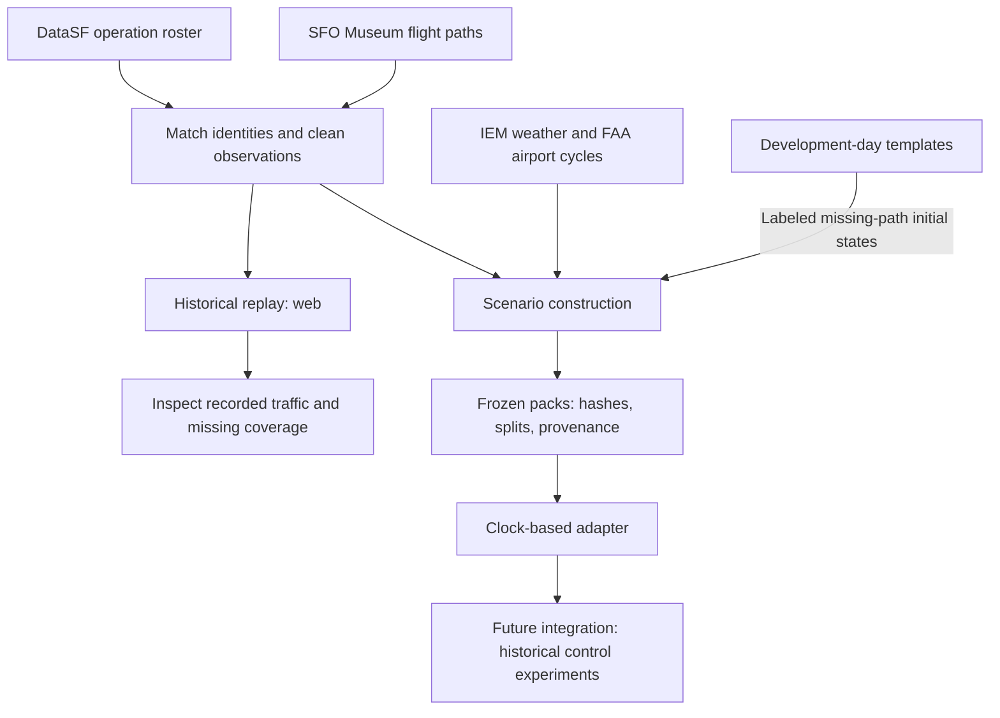
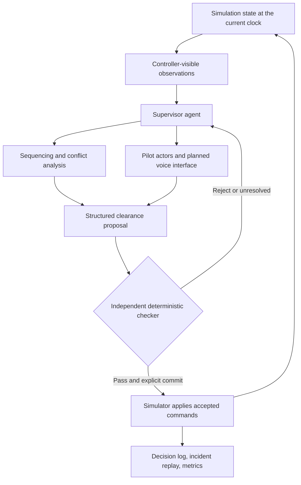
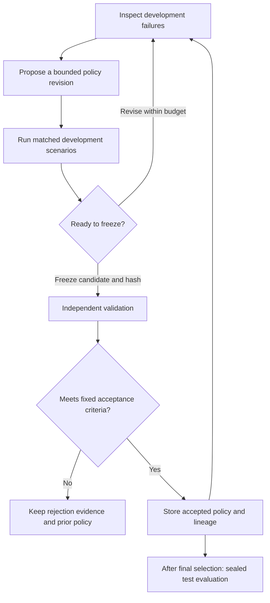

# Up in the Air · Uita


**An AI air traffic control research project: reconstruct a week at SFO, simulate decisions, and test whether agents improve through repeated experiments.**

Built for [The Recursive Agents Hackathon, hosted by Cerebral Valley and Crusoe](https://cerebralvalley.ai/e/crusoe-recursive-agents-hackathon/details).

The goal is an autonomous arrival controller that sequences aircraft, issues clearances, talks to simulated pilots, and learns from its own failures. Historical traffic supplies the starting conditions. A custom simulator computes what happens after each decision. Independent checks decide whether a proposed change earns acceptance.

**Research only.** This project does not control real aircraft. Historical replay, simulated outcomes, and model predictions are separate forms of evidence.

[Project brief](context/brief.md) · [Historical replay](web/README.md) · [Control workbench](docs/DEMO.md) · [Model comparison](benchmark/reports/2026-10-17/comparison.md) · [Data pipeline](pipeline/README.md)

## Why build this?

Air traffic control makes coordination concrete. Aircraft share limited runway space. A delay, runway closure, or weather change can affect many later decisions. A useful controller must track commitments, explain its choices, and recover when conditions change.

That makes it an interesting setting for recursive agents: systems that inspect results, revise their approach, and try again. The research question is whether that loop improves performance on unseen traffic while preserving fixed checks and resource limits.

A convincing demonstration needs more than a plausible radio exchange. It needs repeatable scenarios, matched comparisons, visible failures, and a record of which changes actually helped. Rejected candidates are useful results too.

## What we aim to build

The [brief](context/brief.md) focuses on **August 3–9, 2026, in SFO local time**, within roughly **80 nautical miles** of the airport.

The intended experience follows an arrival rush from entry into the terminal area through landing and simplified runway clearance:

1. Watch real arrival demand enter a simulated SFO airspace.
2. Inspect the controller's aircraft sequence, headings, altitudes, speeds, holds, and landing decisions.
3. Hear simulated pilot readbacks, or speak as a pilot during a selected encounter.
4. Introduce a disruption and inspect the controller's response.
5. Replay an incident, then compare the initial and revised controller on identical conditions.

The broader [agent-team concept](docs/images/agent-team-reference.png) assigns a supervisor to coordinate specialist work. Conflict analysis, sequencing, weather response, and pilot interaction support the arrival task. A full clearance, ground, tower, approach, and en-route organization is a longer-term direction. The supplied concept diagram illustrates that wider scope, not the implemented architecture or validated rule compliance.

## What exists today

The repository contains complementary prototypes. They are **not yet one integrated historical control-and-learning system**.

| Part | What it does | Important boundary |
| --- | --- | --- |
| **Historical replay — `web/`** | Replays the August week with a map, aircraft details, timeline, feed, and traffic metrics. | Observed paths show recorded motion. They do not respond to controller commands. |
| **Control workbench — `backend/` + `frontend/`** | Runs seeded synthetic traffic, disruption injection, reservation planning, independent verification, checkpoint replay, and bounded policy experiments. | Its synthetic scenarios are separate from the historical week. The current learned policy selects optional observations; it does not freely rewrite aircraft control. |
| **Historical data pipeline — `pipeline/`** | Builds cleaned observations, labeled initial states, weather, airport geometry, and frozen scenario packs. Provides Python and TypeScript adapters. | Connecting those packs to the full controller remains integration work. |
| **Arrival-order pilot — `benchmark/`** | Compares five untuned models on which of two recorded arrivals appears first in the roster. | This is a prediction task, not a closed-loop controller evaluation. |

Voice interaction, a complete specialist-agent team, and learned control of the historical week remain goals. The workbench's live Crusoe investigation loop is not yet verified; see [current evidence](#what-the-experiments-show).

## External data and its limits

The project combines demand, observed motion, weather, and airport layout. These sources answer different questions.

| Source | Contribution | Coverage and interpretation |
| --- | --- | --- |
| [DataSF SFO Flight Operations](https://data.sf.gov/d/43zc-xw3x) | Recorded operation times, aircraft identity, origin or destination, and runway. | The extracted week contains **4,220 arrivals** and **4,219 departures**. Operation timestamps are not independently verified touchdown or gate times. |
| [SFO Museum August 2026 flight data](https://github.com/sfomuseum-data/sfomuseum-data-flights-2026-08) · [GeoParquet archive](https://static.sfomuseum.org/parquet/sfomuseum-data-flights-2026-08.parquet) | Available observed flight paths matched to the roster. | The starter arrival bundle has **2,164 matched paths** and **60,535 raw points** within 80 NM. The separate replay also includes **1,964 departure paths**. |
| [Iowa Environmental Mesonet](https://mesonet.agron.iastate.edu/request/download.phtml) | Historical KSFO routine and special weather reports, known as METAR and SPECI. | The scenario pipeline includes **239 reports**, including pre-roll. Report availability uses an explicit five-minute delay assumption. |
| [FAA aeronautical data](https://www.faa.gov/air_traffic/flight_info/aeronav/Aero_Data/NASR_Subscription/) | Runway dimensions, ends, thresholds, and bearings. | Scenario packs select the July 9 or August 6 cycle by date. Geometry alone does not establish historical runway closures or active-runway choices. |
| [ADSB.lol historical archives](https://github.com/adsblol/globe_history_2026) | Optional additional aircraft observations for missing paths and heights. | Candidate backfill requires matching and verification. It is separate from the baseline coverage above. See [backfill methods](pipeline/ADSB_LOL.md). |

These counts describe our extractions, not publisher-certified completeness. **2,056 starter arrivals lack a matched Museum path.** The historical viewer keeps those operations in the roster but leaves their paths missing. Scenario construction can instead create explicitly labeled initial states from development-day templates.

Cleaning removes position spikes and splits long gaps. Ambiguous altitude values remain unknown; source speed fields are not assumed to have verified units. DataSF's naive timestamps are interpreted as `America/Los_Angeles`, with original values preserved. Read the [arrival bundle notes](pipeline/bundle/README.md), [replay methods](pipeline/WEB_REPLAY.md), and [scenario contract](pipeline/README.md) before interpreting metrics.

DataSF identifies its data under PDDL. Museum data uses CDLA-Permissive-1.0. Preserve the bundled [Museum license](pipeline/bundle/SFO-Museum-LICENSE.txt), source attribution, and transformation notes when sharing derived data. The [artwork notes](docs/images/README.md) identify the generated hero illustration.

## From observations to experiments

Historical replay and control experiments use different paths through the same source material:



The scenario adapter releases new aircraft and weather only when the simulation clock reaches their availability time. The controller must not receive future trajectories, final operation order, or the private spawn queue. After a clearance, the simulator must compute new motion rather than replay the historical future.

The pipeline provides DuckDB for local analysis and Railway PostgreSQL storage for frozen artifacts. The standalone historical viewer rebuilds its local files from tracked bundles and needs no database credentials. See the [data handoff](context/data-handoff.md) for integration details.

## Intended control architecture

This diagram describes the **target arrival-control system**. The current workbench implements a narrower planner, verifier, and bounded observation-policy loop.



The checker is ordinary code, separate from the agent. It evaluates modeled separation, runway use, command validity, and evidence freshness. The agent cannot change those checks to make its score improve. Passing a research checker does not establish FAA compliance.

The brief proposes a shared TypeScript simulator for browser and batch runs. Today's control workbench instead uses a Python/FastAPI backend with a React/Three.js frontend. Its [architecture notes](docs/ARCHITECTURE.md) document the implemented behavior and simplifications.

## How improvement should work

The improvement loop changes a bounded controller policy, then tests the frozen candidate against independent criteria:



For the historical-week experiment, August 3–6 support development, August 7 supports validation, and August 8–9 remain held out. Missing-path templates use development days only. Freeze reconstruction rules, simulator behavior, checks, and scoring before the final comparison.

Compare a scripted baseline, the initial agent, and the revised agent with identical traffic and disturbance seeds. Measure completed arrivals, backlog, delay, holding, separation and runway violations, readback errors, decision latency, and model cost. These are planned evaluation dimensions; each experiment must state which it actually measures.

The current workbench narrows the editable policy to selecting and ordering optional observations. It keeps mandatory observations, solver settings, objectives, and verification fixed. Its Pydantic AI investigator can inspect development evidence, evaluate candidates, and revise within time, tool, token, and spend limits. Only accepted artifacts enter persistent policy memory. See [agent architecture](docs/agent-upgrade/ARCHITECTURE.md).

## What the experiments show

- **Historical arrival-order pilot:** five models were compared on the same 141 August 7 pairs. GPT-OSS scored **91/141 (64.5%)**, matching the simple free-flow heuristic. This measures recorded-order agreement, not human controller quality. [Full results and failure accounting](benchmark/reports/2026-10-17/comparison.md).
- **Synthetic workbench:** the matched credential-free fixture study completed both investigator loops and rejected both candidates. Neither met the required improvement over the strong static policy. Fixtures test orchestration; they do not demonstrate model learning. [Fixture results](docs/agent-upgrade/fixture-evaluation.md).
- **Live Crusoe integration:** bounded Nemotron probes did not verify the full investigation tool loop. One probe returned typed JSON but skipped the requested function. No live candidate reached promotion. [Capability evidence and billing limits](docs/agent-upgrade/live-evaluation.md).

There is no demonstrated self-improving historical controller yet. Fine-tuning is deferred, and the historical August 8–9 benchmark remains sealed.

## Run the historical replay

Requires Bun and Python 3. From the repository root:

```sh
cd web
bun install --frozen-lockfile
bun run dev
```

Open [localhost:5174](http://localhost:5174). Startup regenerates ignored local JSON from the tracked source bundles. No model key or database is required. Internet access supplies the basemap tiles.

Choose a day, play or scrub the timeline, and select an aircraft or feed row. Operations without observed paths still count toward roster totals. Sparse path and height coverage limits safety-related metrics; unavailable evidence must not be read as zero incidents.

## Run the control workbench

Requires Python 3.11 and Node.js 22. Default fixture execution needs no model credentials. From the repository root:

```sh
python3.11 -m venv .venv-agent
.venv-agent/bin/pip install -r requirements.lock
npm --prefix frontend ci
PYTHONPATH=backend .venv-agent/bin/uvicorn uita.app:app --host 127.0.0.1 --port 8001
```

In a second terminal:

```sh
npm --prefix frontend run dev -- --host 127.0.0.1
```

Open [localhost:5173](http://localhost:5173). Play or step the simulation, inject a disruption, then propose, verify, and explicitly commit a plan. Inspect evidence or replay a checkpoint. The [demo guide](docs/DEMO.md) describes the workflow; [API documentation](http://localhost:8001/docs) is available while the backend runs.

Optional live inference uses Crusoe Managed Inference and NVIDIA Nemotron. Keep `CRUSOE_API_KEY` server-side and set a finite `CRUSOE_MAX_SPEND_USD` before live work. Read the [agent limits](docs/agent-upgrade/ARCHITECTURE.md) and [known provider failures](docs/agent-upgrade/live-evaluation.md) first. Local startup does not require paid calls.

Docker and Compose support a prepared deployment path. Hosted and PostgreSQL runtime validation have separate requirements; see [operational limits](docs/OPERATIONAL_VALIDATION.md). Run one API worker.

## Verify and explore

Run checks for the part you change:

```sh
# Historical source-to-export checks and UI build
python3 pipeline/verify_web_data.py
(cd web && bun run build)

# Workbench checks and offline matched evaluation
PYTHONPATH=backend .venv-agent/bin/pytest -q
npm --prefix frontend run build
PYTHONPATH=backend .venv-agent/bin/python scripts/evaluate_agent.py
```

The [replay README](web/README.md) includes browser tests. The [pipeline README](pipeline/README.md) covers scenario builds, checksums, storage, and adapters. Evaluation commands generate reports; none of the commands above requests live model inference.

| Start here | What you will find |
| --- | --- |
| [Product brief](context/brief.md) | Intended demo, scope, evaluation plan, and research references. |
| [Design contract](DESIGN.md) | Shared aviation control-room visual direction. Read before changing either frontend. |
| [Replay methods](pipeline/WEB_REPLAY.md) | Timestamps, missing paths, altitude interpretation, and metric limits. |
| [Scenario pipeline](pipeline/README.md) | Frozen data contracts and causal adapters. |
| [Arrival-order benchmark](benchmark/README.md) | Task definition, split isolation, and interpretation. |
| [Workbench architecture](docs/ARCHITECTURE.md) | Planning, trajectories, independent verification, persistence, and modeling limits. |
| [Agent architecture](docs/agent-upgrade/ARCHITECTURE.md) | Investigation tools, memory, budgets, freezing, and promotion. |
| [Research sources](docs/research/SOURCES.md) | Primary references behind the research implementation. |

The source data contains no authentic ATC clearances, radio transcripts, or complete pilot intent. Dialogue, reconstructed entries, and responses to new commands are simulated. Comparisons within this project cannot establish that an agent outperforms real controllers.
