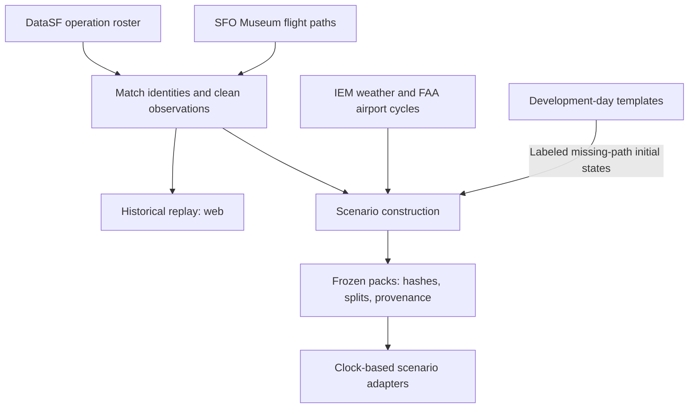
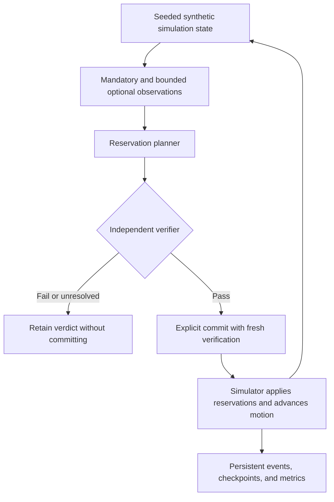
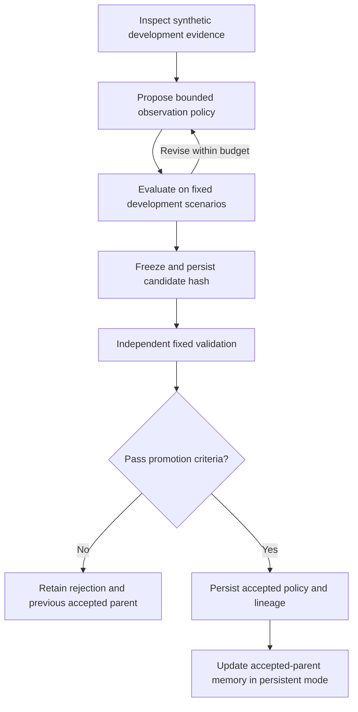

# Up in the Air · Uita

> **Current connected demo:** the production entry is the immersive research shell,
> with an explicitly scripted guided episode, authentic saved Nemotron attempts,
> historical context, synchronized comparison and export. Use the
> [current startup, data, deployment and rollback instructions](docs/research/v2/SHOWCASE.md).
> The standalone voice/gallery descriptions below describe separate experiments;
> they do not control connected research runs. Production uses `showcase/server.mjs`,
> not the Vite development server. Public demo access needs no login.


**Air traffic control research prototypes: historical SFO replay, synthetic scheduling experiments, a voice-enabled showcase, and arrival-order model comparisons.**

Built for [The Recursive Agents Hackathon, hosted by Cerebral Valley and Crusoe](https://cerebralvalley.ai/e/crusoe-recursive-agents-hackathon/details).

Uita replays recorded traffic for **August 3–9, 2026, in SFO local time**, with observed paths within **80 nautical miles** of the airport. A separate control workbench simulates seeded synthetic traffic and evaluates bounded observation policies against fixed checks. The showcase supplies interactive SFO views and simulated radio exchanges; the benchmark compares model predictions of recorded arrival order.

**Research only.** This project does not control real aircraft. Historical replay, simulated outcomes, and model predictions are separate forms of evidence.

[Historical replay](web/README.md) · [Control workbench](docs/DEMO.md) · [Voice showcase](showcase/README.md) · [Model comparison](benchmark/reports/2026-10-17/comparison.md) · [Data pipeline](pipeline/README.md)

## Connected hackathon showcase

The SFO dashboard and tower cab can now run against the durable research API.
The default is an immutable early-August Nemotron recording with historical
context, closure evidence, a matched deterministic comparison and export.
[Startup, staging configuration and actual results](docs/research/v2/SHOWCASE.md).

The recorded model returned no flight clearance before an invalid response
triggered deterministic fallback. Both arms completed 3 arrivals with 29
unfinished and zero modeled violations; no efficiency improvement is claimed.
Live inference is explicit and budgeted; free fixtures are labeled. This
integration is prepared for isolated staging, not deployed to production.
The prototype descriptions below retain their separate boundaries.

## What exists today

The repository contains separate prototypes, with these implemented capabilities and boundaries:

| Part | What it does | Important boundary |
| --- | --- | --- |
| **Historical replay — `web/`** | Replays the August week with a map, aircraft details, timeline, feed, and traffic metrics. | Observed paths show recorded motion. They do not respond to controller commands. |
| **Control workbench — `backend/` + `frontend/`** | Runs seeded synthetic traffic, disruption injection, reservation planning, independent verification, checkpoint replay, and bounded policy experiments. | Its synthetic scenarios are separate from the historical week. Editable policies select, target, and order optional observations; they cannot change flight ordering, solver settings, or verification. |
| **Voice showcase — `showcase/`** | Provides SFO dashboard and tower-cab views, a visualization gallery, structured radio clearances, readback checks, speech synthesis, push-to-talk transcription, and a sector-agent API. | Traffic, decisions, and scores are scripted or mocked unless a page identifies otherwise. Provider-backed voice and agent calls require credentials; these are separate from the workbench investigator. |
| **Historical data pipeline — `pipeline/`** | Builds cleaned observations, labeled initial states, weather, airport geometry, and frozen scenario packs. Provides Python and TypeScript adapters. | These packs do not drive the synthetic control workbench. |
| **Arrival-order pilot — `benchmark/`** | Compares five untuned models on which of two recorded arrivals appears first in the roster. | This is a prediction task, not a closed-loop controller evaluation. |

The workbench's live Crusoe investigation loop has not been verified; see [current evidence](#what-the-experiments-show).

## External data and its limits

The project combines demand, observed motion, weather, and airport layout. These sources answer different questions.

| Source | Contribution | Coverage and interpretation |
| --- | --- | --- |
| [DataSF SFO Flight Operations](https://data.sf.gov/d/43zc-xw3x) | Recorded operation times, aircraft identity, origin or destination, and runway. | The extracted week contains **4,220 arrivals** and **4,219 departures**. Operation timestamps are not independently verified touchdown or gate times. |
| [SFO Museum August 2026 flight data](https://github.com/sfomuseum-data/sfomuseum-data-flights-2026-08) · [GeoParquet archive](https://static.sfomuseum.org/parquet/sfomuseum-data-flights-2026-08.parquet) | Available observed flight paths matched to the roster. | The starter arrival bundle has **2,164 matched paths** and **60,535 raw points** within 80 NM. The separate replay also includes **1,964 departure paths**. |
| [Iowa Environmental Mesonet](https://mesonet.agron.iastate.edu/request/download.phtml) | Historical KSFO routine and special weather reports, known as METAR and SPECI. | The scenario pipeline includes **239 reports**, including pre-roll. Report availability uses an explicit five-minute delay assumption. |
| [FAA aeronautical data](https://www.faa.gov/air_traffic/flight_info/aeronav/Aero_Data/NASR_Subscription/) | Runway dimensions, ends, thresholds, and bearings. | Scenario packs select the July 9 or August 6 cycle by date. Geometry alone does not establish historical runway closures or active-runway choices. |
| [ADSB.lol historical archives](https://github.com/adsblol/globe_history_2026) | Optional additional aircraft observations for missing paths and heights. | Candidate backfill requires matching and verification. It is separate from the baseline coverage above. See [backfill methods](pipeline/ADSB_LOL.md). |

These counts describe our extractions, not publisher-certified completeness. **2,056 starter arrivals lack a matched Museum path.** The historical viewer keeps those operations in the roster but leaves their paths missing. Scenario construction can instead create explicitly labeled initial states from development-day templates.

Cleaning removes position spikes and splits long gaps. Ambiguous altitude values remain unknown; source speed fields are not assumed to have verified units. DataSF's naive timestamps are interpreted as `America/Los_Angeles`, with original values preserved. Read the [arrival bundle notes](pipeline/bundle/README.md), [replay methods](pipeline/WEB_REPLAY.md), and [scenario contract](pipeline/README.md) before interpreting metrics.

DataSF identifies its data under PDDL. Museum data uses CDLA-Permissive-1.0. Preserve the bundled [Museum license](pipeline/bundle/SFO-Museum-LICENSE.txt), source attribution, and transformation notes when sharing derived data. The [artwork notes](docs/images/README.md) identify the generated hero illustration.

## Historical data flow

The historical replay and scenario packs derive from the same recorded sources. The synthetic workbench uses its own seeded demand.



The scenario adapter releases new aircraft and the latest available weather only when the simulation clock reaches their availability time. Its output excludes future trajectories, final operation order, and the private spawn queue. It emits initial states rather than advancing aircraft after spawn.

Historical dataset splits use August 3–6 for development, August 7 for validation, and August 8–9 for test. Missing-path templates use development days only. The arrival-order comparison uses the August 7 validation pairs; its August 8–9 test benchmark remains sealed.

The pipeline provides DuckDB for local analysis and Railway PostgreSQL storage for frozen artifacts. The standalone historical viewer rebuilds its local files from tracked bundles and needs no database credentials. See the [data handoff](context/data-handoff.md) for artifact contracts and storage details.

## Control workbench architecture

The workbench uses a Python/FastAPI backend and a React/Three.js frontend. OR-Tools CP-SAT assigns reservations within a fixed flight ordering. The frontend renders server-computed trajectories.



The verifier checks state and revision binding, evidence freshness, route and closure constraints, runway and taxi reservations, wake spacing, and modeled trajectory separation. Passing plans require an explicit commit, which verifies them again against current state. Policies cannot change these checks. Passing a research checker does not establish FAA compliance.

SQLite is the default local store; a PostgreSQL storage path is also implemented. Commands, policies, experiment jobs, and checkpoints persist. Checkpoint replay and disruption injection are available through the API and workbench. See [architecture and modeling limits](docs/ARCHITECTURE.md).

## Bounded policy experiments

The Pydantic AI investigator inspects development evidence, evaluates observation-policy candidates, and revises within time, tool, evaluation, token, and spend limits. Policies can select and order optional observations and choose their target scope and iteration order. Mandatory observations, flight ordering, solver settings, objectives, and verification stay fixed.



Validation requires feasibility across development and validation cases, fixed resource bounds, at least 1% score improvement over both the strong static policy and accepted parent, and no more than 5% tail-delay regression against the static policy. Validation feedback does not return to the investigator. The current adaptive job workflow leaves the final held-out synthetic suite sealed. Accepted-policy activation is a separate explicit action.

The offline evaluation compares FCFS, the strong static policy, a replayed historical single-proposal policy, and stateless and persistent investigator arms. Reports include delay, backlog, completions, feasibility, solver time, observation counts, investigation resources, latency, and provider usage. Only accepted artifacts enter persistent policy memory; rejected candidates remain in the evidence journal. See [agent architecture](docs/agent-upgrade/ARCHITECTURE.md).

## What the experiments show

- **Historical arrival-order pilot:** five models were compared on the same 141 August 7 pairs. GPT-OSS scored **91/141 (64.5%)**, matching the simple free-flow heuristic. This measures recorded-order agreement, not human controller quality. [Full results and failure accounting](benchmark/reports/2026-10-17/comparison.md).
- **Synthetic workbench:** the matched credential-free fixture study completed both investigator loops and rejected both candidates. Neither met the required improvement over the strong static policy. Fixtures test orchestration; they do not demonstrate model learning. [Fixture results](docs/agent-upgrade/fixture-evaluation.md).
- **Live Crusoe integration:** bounded Nemotron probes did not verify the full investigation tool loop. One probe returned typed JSON but skipped the requested function. No live candidate reached promotion. [Capability evidence and billing limits](docs/agent-upgrade/live-evaluation.md).

These experiments do not demonstrate a self-improving historical controller. No fine-tuning ran, and the historical August 8–9 benchmark remains sealed.

## Run the historical replay

Requires Bun and Python 3. From the repository root:

```sh
cd web
bun install --frozen-lockfile
bun run dev
```

Open [localhost:5174](http://localhost:5174). Startup regenerates ignored local JSON from the tracked source bundles. No model key or database is required. Internet access supplies the basemap tiles.

Choose a day, play or scrub the timeline, and select an aircraft or feed row. Operations without observed paths still count toward roster totals. Sparse path and height coverage limits safety-related metrics; unavailable evidence must not be read as zero incidents.

## Run the control workbench

Requires Python 3.11 and Node.js 22. Default fixture execution needs no model credentials. From the repository root:

```sh
python3.11 -m venv .venv-agent
.venv-agent/bin/pip install -r requirements.lock
npm --prefix frontend ci
PYTHONPATH=backend .venv-agent/bin/uvicorn uita.app:app --host 127.0.0.1 --port 8001
```

In a second terminal:

```sh
npm --prefix frontend run dev -- --host 127.0.0.1
```

Open [localhost:5173](http://localhost:5173). Play or step the simulation, inject a disruption, then propose, verify, and explicitly commit a plan. Inspect evidence or replay a checkpoint. The [demo guide](docs/DEMO.md) describes the workflow; [API documentation](http://localhost:8001/docs) is available while the backend runs.

Optional live inference uses Crusoe Managed Inference and NVIDIA Nemotron. Keep `CRUSOE_API_KEY` server-side and set a finite `CRUSOE_MAX_SPEND_USD` before live work. Read the [agent limits](docs/agent-upgrade/ARCHITECTURE.md) and [known provider failures](docs/agent-upgrade/live-evaluation.md) first. Local startup does not require paid calls.

Docker and Compose support a prepared deployment path. Hosted and PostgreSQL runtime validation have separate requirements; see [operational limits](docs/OPERATIONAL_VALIDATION.md). Run one API worker.

## Run the voice showcase

Requires Node.js 22.12 or newer. From the repository root:

```sh
cd showcase
npm ci
npm run dev -- --port 5175 --strictPort
```

Open [the showcase app](http://127.0.0.1:5175/candidates/app.html) for the SFO dashboard and tower-cab views, or [the gallery](http://127.0.0.1:5175/candidates/) for individual visualization candidates. Port 5175 keeps this separate from the workbench and historical replay.

The showcase's radio modules convert structured clearances to phraseology and check parsed readbacks field by field. The interactive radio loop supports typed pilot messages and microphone input. Scheduling changes go through the showcase scheduler.

Optional environment variables are read by the showcase dev server from its environment files, such as `showcase/.env.local`:

| Variable | Implemented feature |
| --- | --- |
| `OPENAI_API_KEY` | Server-side speech synthesis and transcription, plus the sector-agent endpoint when Crusoe is not configured. |
| `CRUSOE_API_KEY` + `CRUSOE_BASE_URL` | Select Crusoe for the showcase sector-agent endpoint; `CRUSOE_MODEL` overrides its default `openai/gpt-oss-120b`. |
| `GOOGLE_MAPS_API_KEY` | Google Photorealistic 3D Tiles for the SFO views. This key is delivered to the browser and needs HTTP-referrer restrictions. |

Without voice credentials, the radio loop uses browser speech synthesis and browser speech recognition where supported. Sector requests use a keyword fallback when no provider is configured or a request fails. Implemented provider routes do not establish that live services succeeded in a given session. The workbench's Nemotron investigation results above concern a separate integration.

See the [showcase README](showcase/README.md) for individual views, assets, and hosted configuration. Binding beyond localhost requires `DEMO_PASSWORD`.

## Verify and explore

After installing dependencies for the relevant prototype, run checks from the repository root:

```sh
# Historical source-to-export checks and UI build
python3 pipeline/build_web_data.py
python3 pipeline/verify_web_data.py
(cd web && bun run build)

# Workbench checks and offline matched evaluation
PYTHONPATH=backend .venv-agent/bin/pytest -q
npm --prefix frontend run build
PYTHONPATH=backend .venv-agent/bin/python scripts/evaluate_agent.py

# Showcase radio/scheduler tests and build
npm --prefix showcase test
npm --prefix showcase run build
```

The [replay README](web/README.md) includes browser tests. The [pipeline README](pipeline/README.md) covers scenario builds, checksums, storage, and adapters. `scripts/evaluate_agent.py` regenerates `docs/agent-upgrade/fixture-evaluation.json` and its Markdown report. None of the commands above requests live model inference.

| Start here | What you will find |
| --- | --- |
| [Voice showcase](showcase/README.md) | SFO views, radio modules, provider configuration, and asset credits. |
| [Design contract](DESIGN.md) | Shared aviation control-room visual direction for interface work. |
| [Replay methods](pipeline/WEB_REPLAY.md) | Timestamps, missing paths, altitude interpretation, and metric limits. |
| [Scenario pipeline](pipeline/README.md) | Frozen data contracts and causal adapters. |
| [Arrival-order benchmark](benchmark/README.md) | Task definition, split isolation, and interpretation. |
| [Workbench architecture](docs/ARCHITECTURE.md) | Planning, trajectories, independent verification, persistence, and modeling limits. |
| [Agent architecture](docs/agent-upgrade/ARCHITECTURE.md) | Investigation tools, memory, budgets, freezing, and promotion. |
| [Research sources](docs/research/SOURCES.md) | Primary references behind the research implementation. |

The source data contains no authentic ATC clearances, radio transcripts, or complete pilot intent. Dialogue, reconstructed entries, and responses to new commands are simulated. Comparisons within this project cannot establish that an agent outperforms real controllers.

The connected showcase defaults to login-free public demo access. Visitors share
the research workspace, including explicit budgeted live runs. Set
`UITA_ACCESS_MODE=private` to require accounts. See
[access and startup instructions](docs/research/v2/SHOWCASE.md).

The default demo now uses two evidence-grounded **synthetic arrival streams** with
bounded turns, staged descent, merge timing and sourced runway geometry. See
[route evidence, measured density and limitations](docs/research/v2/SHOWCASE.md#converging-arrival-flows-arrival-flows-v1).
