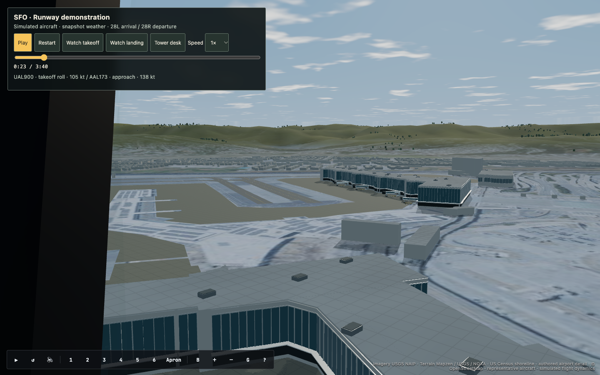
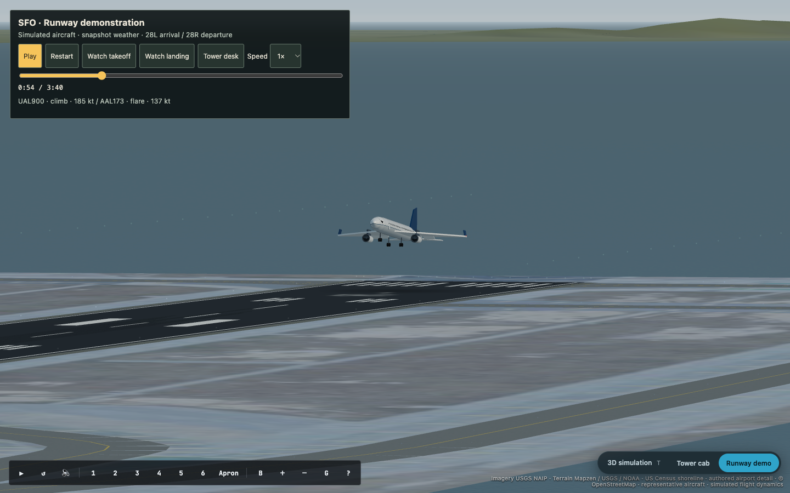

# Tower scenery verification — October 21, 2026

The tower now uses sampled terrain, shoreline geometry, detailed Blender airport
buildings, textured aprons and taxiways, sky reflections, clouds, and smoother
aircraft with visible windows and engine details. An Apron camera exposes the
terminal detail. All aircraft source positions and flight dynamics stay intact.

## Evidence

- Headless Blender MCP generated the airport asset, rendered its preview, and
  confirmed `bpy.app.background == True`.
- Built-in Codex Browser inspection covered departure geometry, terrain, water,
  terminal detail and responsive controls. Its final console error list was empty.
- Browser tests: 3 physics checks and 7 realism/scenery checks passed. They covered
  takeoff, flare, touchdown, taxi exit, camera changes, pause, hidden-view pause,
  historical altitude preservation, mobile controls, finite scenery geometry,
  and fallback after blocking the airport asset.
- The existing shell test referenced a sandbox toggle removed by an earlier
  change. Those obsolete assertions were removed; playback and source isolation
  assertions remain.
- Showcase build and TypeScript check passed; 32 existing showcase tests passed.
  Frontend trace assets also built successfully. Vite reported its existing large
  bundle warnings.
- A five-second loaded-scene sample at 1440 × 900 measured 120.7 FPS, 8.3 ms median,
  and 9.1 ms p95 frame spacing on Apple M5 Pro / Chromium WebGL2. It rendered
  approximately 1.83 million triangles and 293 draw calls in the sampled frame.
  This is one machine and view, not a hardware-independent performance guarantee.

## Visual evidence

See [asset provenance and reproduction](../../../showcase/assets/source/tower-realism/README.md).
Facades, vegetation, equipment, aircraft and sky are authored approximations.
The existing aerial imagery limits close-range ground detail. This is not a
photogrammetry reconstruction or an exact airport/aircraft engineering model.
